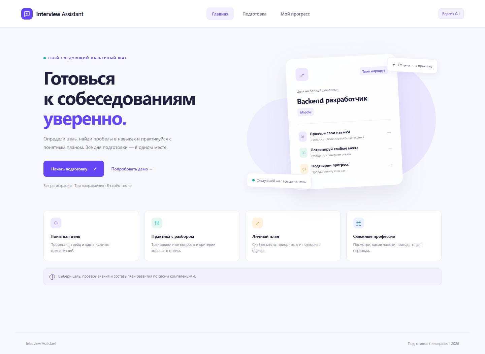

# Interview Assistant

Персональный помощник для подготовки к собеседованиям. Пользователь выбирает профессию и грейд, видит компетенции, проходит тренировку или оценку и получает следующий шаг.

**Контрольная точка 1:** SDD-документация и работающий интерактивный интерфейс. Внешний AI, RAG, сервер и объективная оценка готовности пока не реализованы. Все вопросы локальные; разбор ищет ключевые слова. [Текущее состояние](STATUS.md).

## Команда

| Участник | Зона ответственности | Результат на КТ1 / следующий этап |
| --- | --- | --- |
| Алексей Жеребенков | Продукт и фронтенд: сценарии, документация Product, макеты и интерфейс | Интерфейс и продуктовая спецификация / проверка удобства |
| Ясевичусь Артур | Интеграция: связь интерфейса, поиска и вызова LLM | Контракт API и архитектура / сервис сессий и оценивания |
| Солижонов Умиджон | RAG: корпус, индекс, поиск и benchmark | План корпуса и метрик / загрузка источников и retrieval |

## Быстрый запуск

Нужны **Node.js 20+** и npm. Сторонних зависимостей и ключей API нет.

```bash
git clone https://github.com/greg-goozmer/helper_for_job.git
cd helper_for_job/code/frontend
npm ci
npm run dev
```

Откройте **http://localhost:5173**. Остановка — Ctrl+C. Приложение запускается и без установки пакетов: `npm run dev`.

```bash
npm run check
npm test
```

[Подробная инструкция, включая PowerShell](docs/Tech/02-running.md).

## Интерфейс

Фиолетовая палитра и расположение экранов основаны на предоставленных макетах; реализация упрощена для КТ1. Доступны Backend, Frontend и аналитика данных. Выбор грейда сохраняется, но вопросы ещё не калиброваны по уровням.



[Исходные макеты](docs/assets/interface-mockups.png) · [Продуктовая презентация](docs/assets/product-pitch.pptx)

## Структура репозитория

```text
helper_for_job/
├── README.md
├── AGENTS.md
├── STATUS.md
├── CHANGE_HISTORY.md
├── docs/
│   ├── Product/        контекст, сценарии, требования, интерфейс, правила
│   ├── Tech/           архитектура, запуск, данные, API, проверки
│   ├── Service/        решения, источники и протокол проверок
│   ├── assets/         исходные материалы и скриншоты
│   └── document-manifest.json
└── code/
    ├── frontend/       HTML, CSS, JavaScript; без внешних библиотек
    ├── scripts/        локальный HTTP-сервер
    ├── data/           описание будущего корпуса RAG
    ├── backend/        план интеграции; сервера пока нет
    ├── tests/          проверки логики приложения
    └── benchmark/      план измерения качества retrieval
```

Документация следует структуре [minecraft-mod-picker](https://github.com/rowapepe/minecraft-mod-picker); код и содержание написаны для Interview Assistant. [Карта документации](docs/README.md) · [Источники](docs/Service/sources.md).

## Текущее состояние

- Данные профиля и последние 10 оценок хранятся только в localStorage этого браузера. Тексты ответов не сохраняются.
- Тренировочные ответы и незавершённые сессии живут в памяти до перезагрузки.
- Разбор проверяет упоминания терминов; он не оценивает корректность рассуждений.
- Один и тот же набор из трёх вопросов повторяется. Рост процента не доказывает рост навыка.
- Для реального продукта запланированы RAG с источниками, competency graph и оценивание по рубрике.

