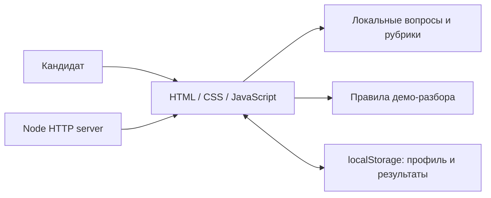
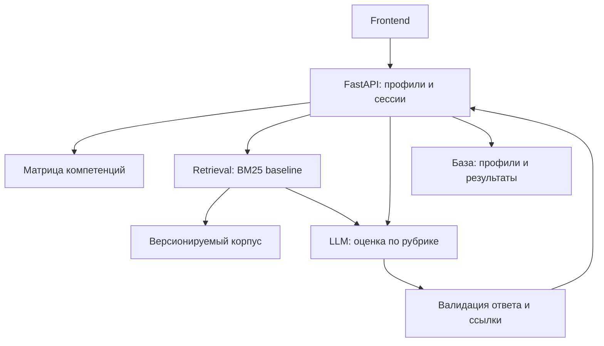

# Архитектура

## Реализовано на КТ1

Frontend без framework и сторонних зависимостей: модули ES, маршруты в URL hash, шаблоны с экранированием пользовательского текста. Node-сервер раздаёт только файлы интерфейса на loopback. Он не является API и не обрабатывает ответы. Все расчёты выполняются в браузере.

## Целевая архитектура следующего этапа

Технологии целевой системы — проектное решение, не установленное ПО. Сначала BM25 baseline; embeddings/hybrid добавляются только после измерения качества. Не нужен отдельный графовый сервер, пока небольшую матрицу можно хранить таблицами.

## Поток RAG

Куратор проверяет источник → нормализует документ и права → разбивает на фрагменты → строит индекс → запрос ограничивается профессией/грейдом/навыком → retrieval возвращает top-k с источниками → LLM получает рубрику и фрагменты → сервер проверяет структуру и ссылки.

Текст источников считается данными. Инструкции из найденного материала не могут менять системные правила или вызывать инструменты.

## Отказы

Пустая выдача → сообщить о нехватке источников. Сбой LLM → не выдумывать оценку, сохранить возможность повторить. Смена версии рубрики → отдельная серия сравнения. Таймаут и повтор завершения сессии → серверная идемпотентность.

